

  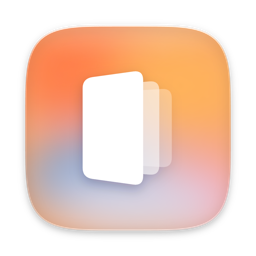

<h1 align="center">WATCHIT</h1>

  <b>Les films d'un disque dur, comme un site de streaming à toi.</b> 
  Branche le disque sur un Mac, double-clique sur ▶ WATCH : tes films et tes séries s'ouvrent dans le navigateur. Pas de compte, pas d'internet, rien à installer.

  
  
  
  

  <a href="README.md">🇬🇧 Read in English</a>

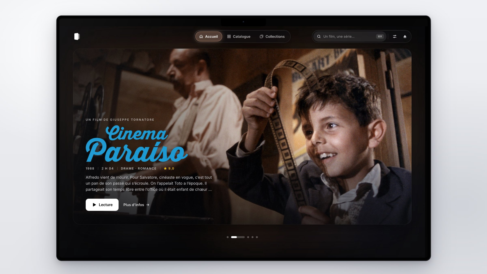

## Ce que ça fait

### Un écran de cinéma à la maison

L'accueil projette un film à la fois sur un écran aux coins arrondis, entouré d'un halo doux à ses couleurs. Le titre est dessiné avec le logo du film, sous le nom du réalisateur et une ligne de générique. Il passe tout seul au film suivant.

  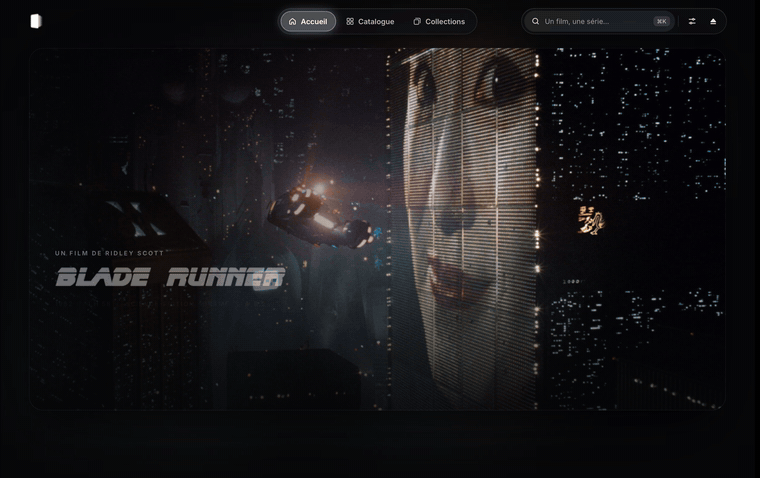

### Un aperçu au survol

Pose la souris sur une affiche : une lumière à la couleur du film s'allume derrière. Reste un instant et un aperçu sort de l'affiche, avec une scène, le résumé et un bouton Lecture.

  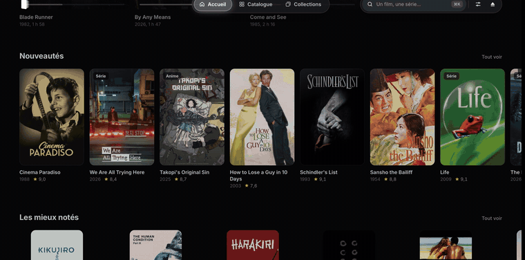

### ⌘ K · Tout retrouver

Un mur d'affiches qui se resserre pendant qu'on tape : titres, réalisateurs, acteurs, années.

  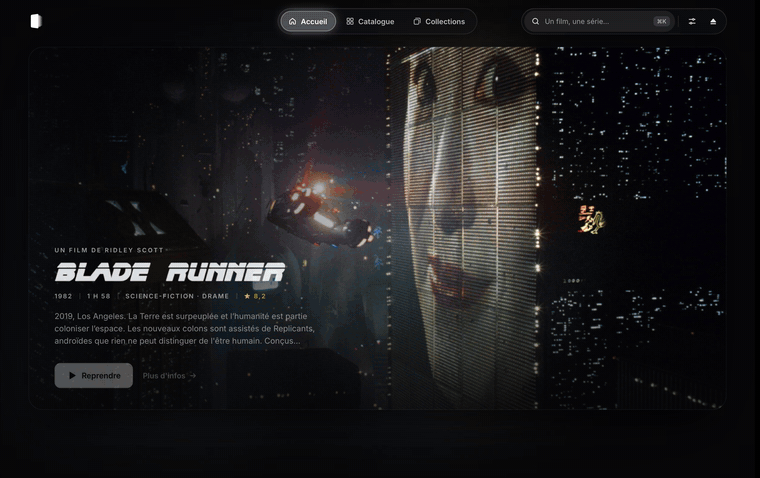

### Par année et par genre

Le catalogue étale toutes les années du disque sur une frise : glisse dessus pour choisir une période. Les genres sont des vignettes, chacune avec une scène de son meilleur film.

  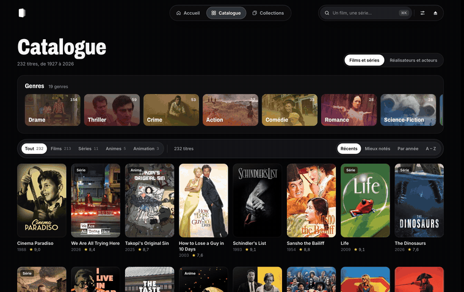

### Réalisateurs et acteurs

Chaque film montre son réalisateur et sa distribution. Un clic sur un nom ouvre sa page : un portrait, une courte biographie, et tous ses films du disque sur une frise. Le catalogue leur consacre aussi une page, avec une recherche.

  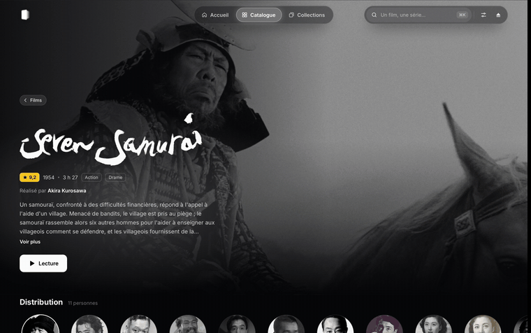

### Les collections, dans l'ordre

Les sagas sont des tranches de leurs films ; chacune s'ouvre sous la souris. ▶ lance le prochain film pas encore vu.

  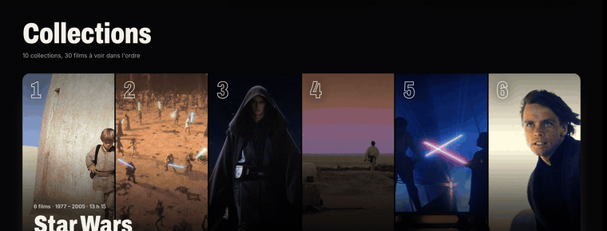

### Sombre ou clair

Une salle de cinéma, ou une page de papier chaud. Les images gardent leur voile sombre dans les deux, et les barres de boutons passent en verre fumé.

  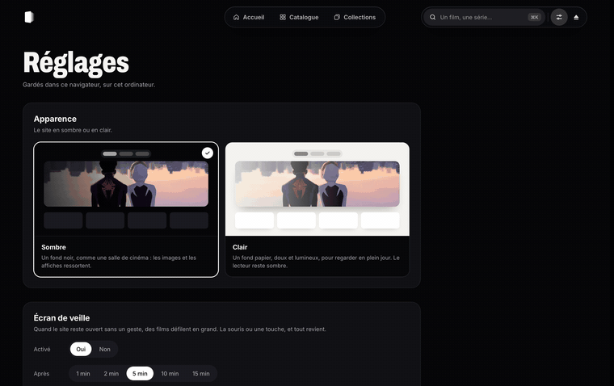

### Un écran de veille pour tes films

Laisse-le quelques minutes et les films défilent : des scènes en plein écran, ou un mur d'affiches qui dérive doucement, l'une s'allumant de temps en temps.

  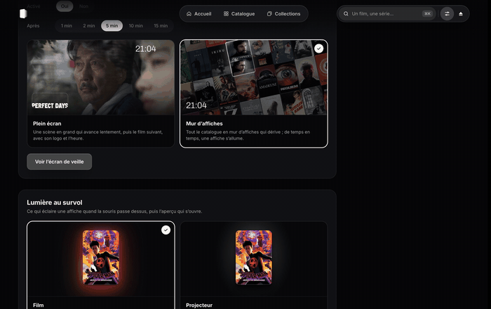

### Une fin de séance

⏏ arrête le site pour qu'on puisse éjecter le disque. Le dernier écran rappelle où l'on s'est arrêté.

  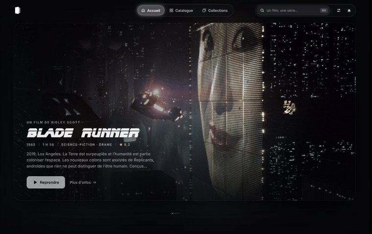

### Quelques détails

- Reprend là où tu t'étais arrêté, film ou épisode. La progression est enregistrée sur le disque lui-même : elle le suit sur un autre Mac.
- Lit les vidéos du disque telles quelles, avec leurs sous-titres et leurs pistes audio.
- Un film ou une série déposé dans le dossier du disque apparaît tout seul.
- Au clavier : ⌘ K pour chercher, Échap pour fermer, Espace pour mettre en pause.
- Le site s'arrête tout seul une minute et demie après la fermeture de son dernier onglet.

## Comment c'est fait

- Un serveur Node.js sans dépendance ; HTML, CSS et JavaScript, sans framework ni étape de build.
- Node et FFmpeg voyagent sur le disque : le Mac n'a rien à installer.
- Les fiches, logos, distributions et portraits viennent une fois de [TMDB](https://www.themoviedb.org) par de petits scripts, puis restent sur le disque : le site marche sans internet.
- ▶ WATCH est une petite app Swift qui lance le site et ouvre le navigateur.
