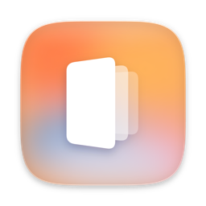
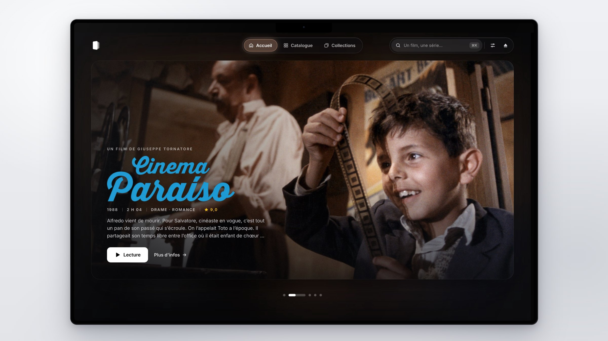
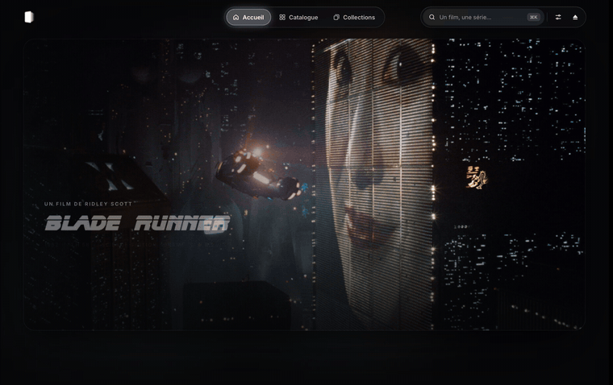
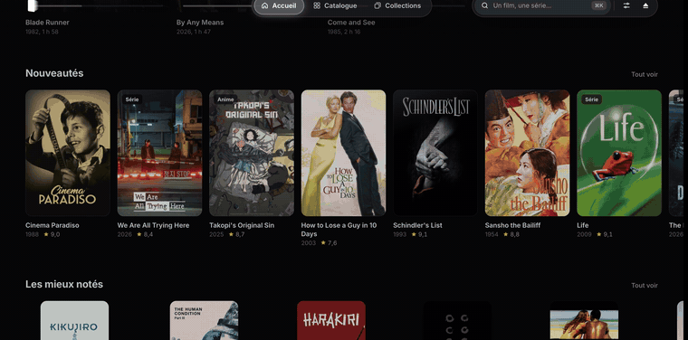
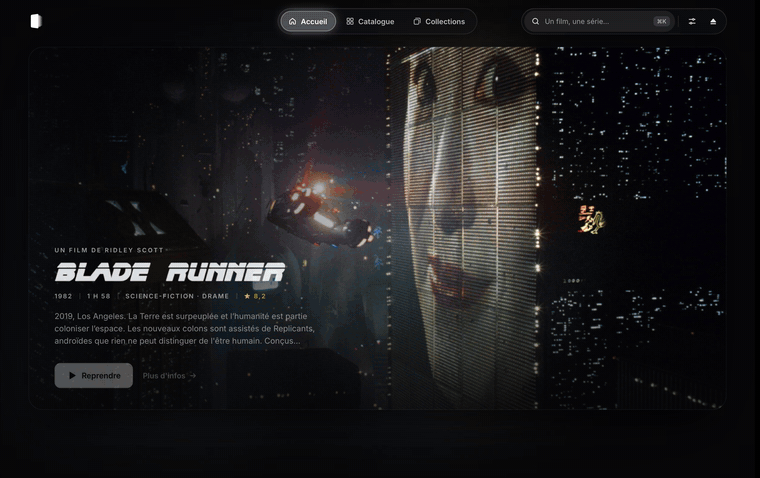
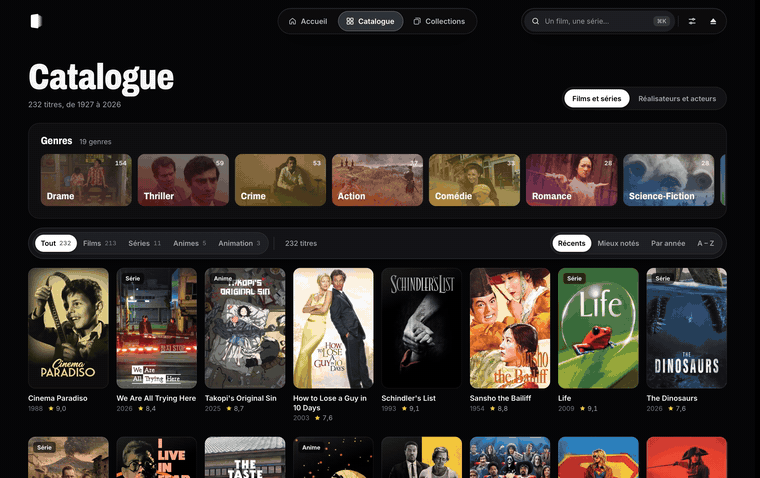
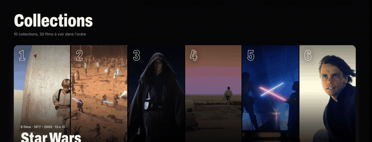
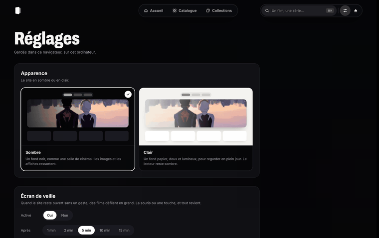
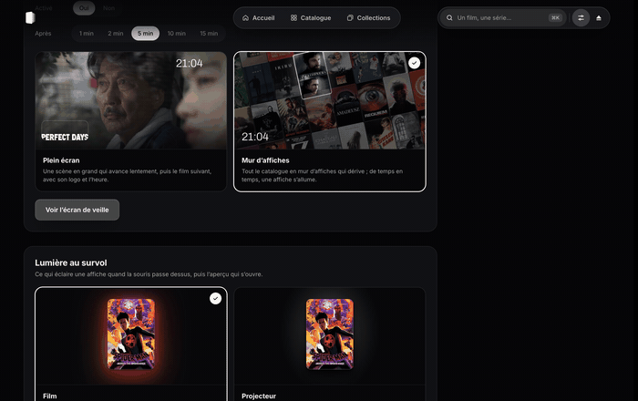
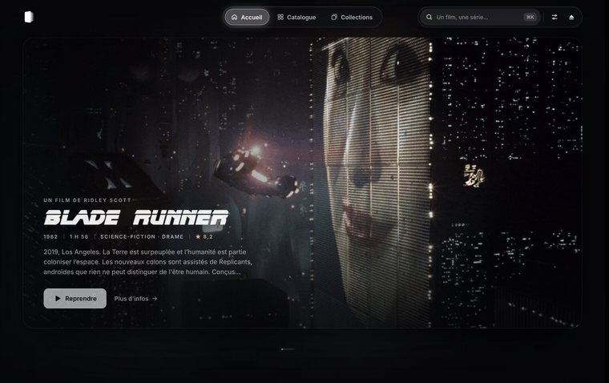

  

<h1 align="center">WATCHIT</h1>

  <b>Your movies on a hard drive, as your own streaming site.</b> 
  Plug the drive into a Mac, double-click ▶ WATCH, and your films and series open in the browser. No account, no internet, nothing to install.

  
  
  
  

  <a href="README.fr.md">🇫🇷 Lire en français</a>

## What it does

### A cinema screen at home

The home page projects one film at a time on a screen with rounded corners, a soft halo of its colors around it. The title is drawn with the film's own logo, under the director's name and a line of credits. It moves on to the next film by itself.

  

### Hover for a preview

Rest the pointer on a poster: a light in the film's colors glows behind it. Stay a moment and a preview slides out of the poster, with a scene, the synopsis and a Play button.

  

### ⌘ K · Find anything

A wall of posters that narrows down as you type: titles, directors, actors, years.

  

### Browse by year and genre

The catalogue lays every year on the drive out on a timeline: drag across it to pick a period. Genres come as tiles, each with a scene from its best film.

  

### Directors and actors

Every film shows its director and cast. Click a name to open their page: a portrait, a short biography, and all their films on the drive along a timeline. The catalogue has a page of its own for them, with a search.

  

### Collections, in order

Sagas are shown as slices of their films; each one opens up under the pointer. ▶ plays the next film you haven't seen.

  

### Light or dark

A dark cinema, or a warm paper page. Images keep their dark veil either way, and the button bars turn to smoked glass.

  

### A screensaver for your films

Leave it alone for a few minutes and the films parade by: scenes in full screen, or a wall of posters drifting slowly, one lighting up now and then.

  

### Ends like a movie

⏏ stops the site so the drive can be ejected. The last screen reminds you where you stopped.

  

### Some details

- Picks up where you left off, film or episode. Progress is saved on the drive itself, so it follows the drive to another Mac.
- Plays the drive's videos as they are, with their subtitles and audio tracks.
- A film or series dropped into the drive's folder shows up on its own.
- Keyboard: ⌘ K to search, Esc to close, Space to pause.
- The site stops by itself a minute and a half after its last tab is closed.
- The interface is in French.

## How it's made

- A Node.js server with no dependencies; HTML, CSS and JavaScript, no framework, no build step.
- Node and FFmpeg travel on the drive, so the Mac needs nothing installed.
- Film details, logos, casts and portraits are fetched once from [TMDB](https://www.themoviedb.org) by small scripts, then stay on the drive: the site works without internet.
- ▶ WATCH is a small Swift app that starts the site and opens the browser.
